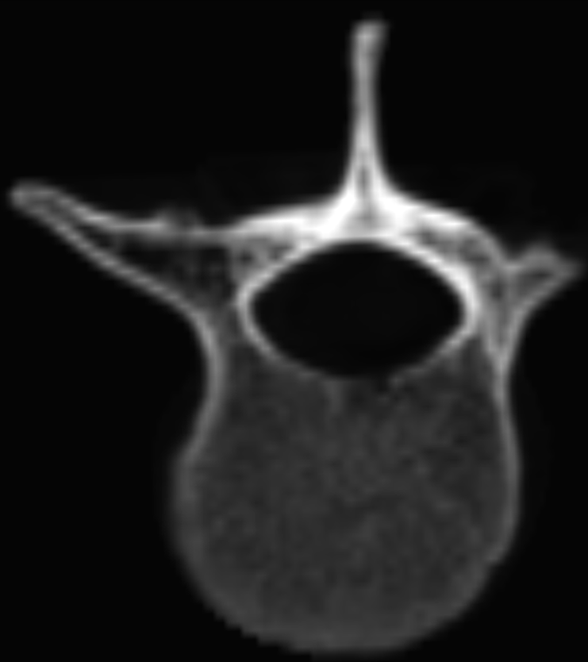
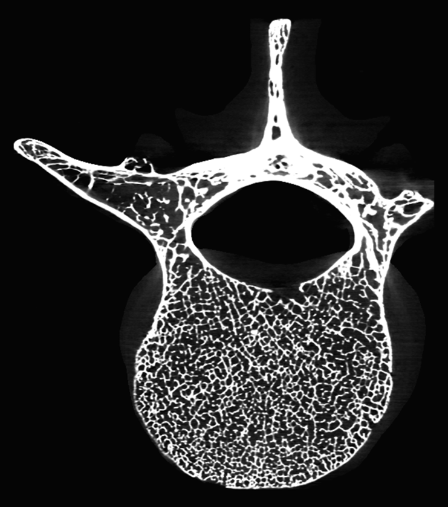

<h1 align="center">LSR-2027</h1>
<p align="center"><strong>Ex Vivo Lumbar CT Super-Resolution and Quantitative Bone Biomarkers</strong></p>
<p align="center">Proposed MICCAI 2027 Challenge</p>
<p align="center">
  <a href="https://frankzhangrp.github.io/LSR-2027/">Project website</a> ·
  <a href="#three-tracks">Tracks</a> ·
  <a href="#quick-start">Quick start</a> ·
  <a href="evaluation/protocol.md">Evaluation protocol</a> ·
  <a href="https://doi.org/10.5281/zenodo.19404387">Public dataset</a>
</p>

LSR-2027 asks how much trabecular detail can be reconstructed from coarser CT, and how accurately routine CT can estimate an individual vertebra’s bone volume fraction. The three tracks evaluate paired scans of ex vivo lumbar specimens.

<table>
  <thead>
    <tr>
      <th>Routine CT</th>
      <th>Paired Micro-PCCT</th>
    </tr>
  </thead>
  <tbody>
    <tr>
      <td align="center"></td>
      <td align="center"></td>
    </tr>
    <tr>
      <td align="center">586 µm in-plane · 1,000 µm slice · soft-tissue kernel</td>
      <td align="center">105 µm isotropic voxel sampling</td>
    </tr>
  </tbody>
</table>

Matched axial images from the published LumbarSR collection. The interactive viewer also shows coronal and sagittal views. [Explore the paired scans](https://frankzhangrp.github.io/LSR-2027/#viewer-title)

## Three tracks

| Track | Input → required output | Evaluation |
| --- | --- | --- |
| **T1 · Routine CT to Micro-PCCT** | One routine CT volume → a reconstruction on the paired 105 µm Micro-PCCT grid | Fixed and cross-protocol assessment within one track. Candidate structure metrics are local BV/TV MAE and trabecular spatial F1. |
| **T2 · Clinical-grade PCCT super-resolution** | A coarser clinical-grade PCCT reconstruction → the finer grid of the same specimen | The apparent trabecular separation (Tb.Sp) endpoint depends on paired geometry, effective resolution and repeatability. |
| **T3 · Trabecular biomarker estimation** | One prespecified routine CT reconstruction → one trabecular bone volume fraction (BV/TV, %) per vertebra | Rank by specimen-level mean absolute error (MAE) in percentage points against a qualified 3D Micro-PCCT reference. Report signed bias and specimen count. |

T1 and T2 report **PSNR, 3D SSIM, intensity MAE, RMSE and signed intensity bias** in a fixed three-dimensional evaluation region. Structural ranking for T1 and T2 is under development. The protocol specifies the reference grids, aggregation, candidate ranking rules and qualification checks. [Read the evaluation protocol](evaluation/protocol.md)

T3 compares routine CT attenuation regression, direct prediction and super-resolution-assisted quantification against the same reference. Apparent Tb.Sp is a secondary endpoint candidate subject to reference repeatability and resolution checks.

## Data and phases

The published LumbarSR collection includes 30 paired specimens with eight routine CT acquisition and reconstruction configurations, 105 µm Micro-PCCT, and registered volumes. T1 and T3 are proposed to use those specimens for development, with separate private feedback and final sets.

| T1 and T3 split | Vertebrae | Purpose |
| --- | ---: | --- |
| Public development | 30 | Model development and reproducible comparisons |
| Private phase A | 10 | Limited feedback |
| Private phase B | 10 | Final blind evaluation of frozen submissions |

T2 pairing, geometry and split counts are being verified separately. Each specimen and its derivatives stay in the same split across tasks, with donor-level grouping where linkage is available. [Published data descriptor](https://doi.org/10.1038/s41597-026-07748-5) · [Zenodo dataset](https://doi.org/10.5281/zenodo.19404387)

## Quick start

The scoring preview uses Python 3.9+ and its standard library. From the repository root, run the synthetic T3 example and the regression tests for all three tracks.

```sh
python3 evaluation/score_bvtv.py \
  --reference evaluation/examples/reference.csv \
  --predictions evaluation/examples/predictions.csv

python3 -m unittest discover -s evaluation -p 'test_*.py'
```

The two-specimen example returns **2.0 percentage points MAE** and **−1.0 percentage points signed bias**. To evaluate T1 or T2 predictions, follow the manifest and NIfTI input contract. [Scoring commands and file formats](evaluation/README.md)

## Published resources

- Wang et al., *LumbarSR: A Paired Clinical CT and Photon-Counting Micro-CT Dataset for Human Lumbar Vertebrae*. *Scientific Data* **13**, 1506 (2026). [Data descriptor](https://doi.org/10.1038/s41597-026-07748-5)
- Paired scans and registered volumes from the original LumbarSR release. [Zenodo record 19404387](https://doi.org/10.5281/zenodo.19404387)
- Registration, morphometry and published reconstruction baselines, including interpolation, SRCNN, U-Net, ESRGAN and SwinIR. [LumbarSR baseline repository](https://github.com/FrankZhangRp/LumbarSR-Challenge)

## Organizing team

Ping Wang · Ruipeng Zhang · Mengfei Wang · Yao Zeng · Zhuo Li · Yunyi Li · Dan Wang† · Xiaoer Wei† · Yueqi Zhu† · Yuehua Li†

† Corresponding author. Yuehua Li is the last and a corresponding author.
